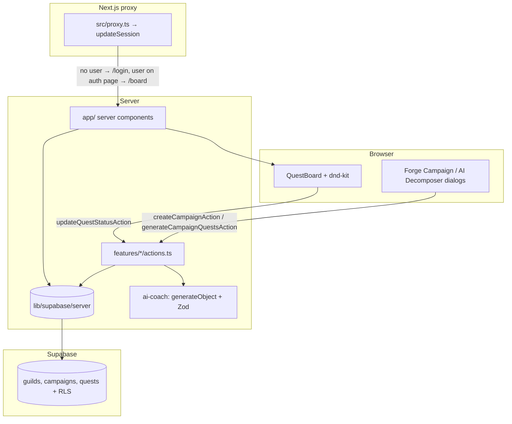

# The Daily Quest — Architecture

> **Living document rule (for humans and AI):** Before editing this file, read the existing `ARCHITECTURE.md` and scan the current codebase. Merge updates intelligently—preserve accurate history, note what changed, and do not blindly overwrite prior sections. Update the [Document history](#document-history) entry for each meaningful revision.

---

## The Vision

**The Daily Quest** (repo: `questos`) is an AI-ready **gamified accountability coach** dressed as a medieval tavern notice board. Adventurers (users) belong to **guilds**, forge **campaigns** (goals), break them into **quests** on a Kanban board, and earn XP when they complete work—turning daily habits into a lightweight RPG loop.

Evolution so far:

1. **Phase 1 — browser prototype:** quests in `localStorage`.
2. **Phase 2 — cloud MVP:** Supabase auth + a per-user `quests` table, all client-side (`useQuests` / `useAuth` hooks).
3. **Phase 2.5 — server-first (current):** Next.js 16 server components + server actions, `@supabase/ssr` cookie sessions gated by `proxy.ts`, a guild/campaign/quest schema with RLS in versioned migrations, and the first **AI coach** feature (campaign → quest decomposition).

---

## Tech Stack

| Layer | Technology | Role |
|--------|------------|------|
| Framework | **Next.js 16** (App Router, Turbopack) | Server components for data loading, server actions for mutations, `proxy.ts` for session gating |
| UI | **React 19**, **Tailwind CSS v4**, `lucide-react` | Tavern-themed shell; `useActionState` forms |
| Drag & drop | **@dnd-kit** (`core`, `sortable`, `utilities`) | Kanban columns and cards |
| Backend / auth | **Supabase** via `@supabase/ssr` | Postgres (guilds, campaigns, quests, profiles), email/password auth, cookie-based sessions |
| AI | **Vercel AI SDK** (`ai`, `@ai-sdk/openai`) + **Zod** | Structured quest generation; OpenAI when `OPENAI_API_KEY` is set, otherwise a local Ollama model |
| Language | **TypeScript** | Domain types derived from generated `src/types/database.types.ts` |

**Environment (`.env.local`):** `NEXT_PUBLIC_SUPABASE_URL`, `NEXT_PUBLIC_SUPABASE_ANON_KEY`, and optionally `OPENAI_API_KEY`, `OLLAMA_BASE_URL`, `OLLAMA_MODEL`.

---

## Project layout

Application code lives under `src/` (config, `public/` and `supabase/` stay at the root). The code is organized **by feature**; `app/` only does routing.

```
src/
├── app/                        # routing only: pages, layouts, globals.css
│   ├── (auth)/                 # /login, /signup
│   └── (dashboard)/            # /board, /board/[campaignId], /dashboard, /records
├── features/
│   ├── auth/                   # actions.ts (login/signup/signout), components/ (forms)
│   ├── campaigns/              # actions.ts (createCampaignAction), components/ (Forge Campaign dialog)
│   ├── quests/                 # actions.ts, constants.ts, drag.ts, components/ (board, column, card)
│   └── ai-coach/               # actions.ts, models.ts, schemas.ts, components/ (decomposer dialog)
├── components/
│   ├── ui/                     # shared primitives (SubmitButton; shadcn target)
│   └── layout/                 # app shell: AppSidebar, AppHeader
├── lib/
│   ├── supabase/               # client.ts (browser), server.ts (RSC/actions), proxy.ts (session refresh)
│   └── utils.ts                # cn()
├── types/
│   ├── database.types.ts       # generated by Supabase CLI — do not edit by hand
│   └── index.ts                # single source of domain types (Quest, Campaign, QuestStatus, …)
└── proxy.ts                    # Next 16 proxy (formerly middleware) → lib/supabase/proxy.ts
supabase/
├── migrations/                 # schema tables, security functions, RLS policies
└── seed.sql
```

**Conventions**

- `app/` pages stay thin: fetch data with `@/lib/supabase/server`, render components from `@/features/*`.
- Features do not import from each other; anything shared moves to `components/`, `lib/` or `types/`.
- Server-only modules (`lib/supabase/server.ts`, `features/ai-coach/models.ts`) import `server-only` so they can never be bundled into client code.
- File names are kebab-case; import via the `@/*` → `src/*` alias.
- Domain types come from `@/types`, never redefined locally.

---

## Application State & Data Flow



1. **Every request** passes through `src/proxy.ts`, which refreshes the Supabase cookie session and redirects unauthenticated users to `/login` (and authenticated users away from `/login`/`/signup` to `/board`).
2. **`/board`** lists campaigns server-side; **Forge Campaign** calls `createCampaignAction`, which resolves the user's guild via `guild_members`, inserts a campaign and redirects to `/board/[campaignId]`.
3. **`/board/[campaignId]`** loads the campaign's quests server-side and hands them to the client `QuestBoard`.
4. **Dragging** a card updates local state and calls `updateQuestStatusAction`.
5. **AI decomposition:** `generateCampaignQuestsAction` asks the model for a `CampaignDecompositionSchema` object, bulk-inserts the quests, and `revalidatePath`s the board.

### Legacy (Phase 1–2)

The client-side `useQuests`/`useAuth` hooks, `AuthForm`, `KanbanBoard`, `lib/quests/storage.ts` and `TavernBoard` are gone. `STORAGE_KEY` in `features/quests/constants.ts` is a leftover from the localStorage prototype.

---

## Gamification Engine

Constants in [`src/features/quests/constants.ts`](src/features/quests/constants.ts): `XP_PER_QUEST = 50`, `XP_PER_MILESTONE = 250`. The DB carries `quests.xp_reward` and `profiles.total_xp`.

**Current state:** XP is **not awarded** in the server-first rewrite yet. The scroll card shows a hard-coded `+100 XP` / `+40 XP`, which disagrees with the constants. The Phase 2 rule (award once when a quest first enters `completed`, `level = floor(xp / 100) + 1`) is the intended behavior to restore—ideally server-side, writing `profiles.total_xp`.

---

## Database Schema

Versioned in `supabase/migrations/`:

| Migration | Contents |
|-----------|----------|
| `…01_schema_tables.sql` | `profiles`, `guilds`, `guild_members`, `campaigns`, `quests`; enums `guild_role`, `quest_status`, `campaign_status`, `quest_priorities` |
| `…02_security_functions.sql` | `SECURITY DEFINER` helpers used by policies (avoid RLS recursion, Postgres 42P17) |
| `…03_rls_policies.sql` | Row Level Security policies (guild-membership based) |

Regenerate `src/types/database.types.ts` with the Supabase CLI after any schema change; `src/types/index.ts` derives `Quest`, `Campaign`, etc. from it. Note the generated `quests.status` and `is_milestone` columns are nullable.

---

## Authentication & Security

- **Session:** `@supabase/ssr` cookies; refreshed in `lib/supabase/proxy.ts` on every matched request.
- **Route gating:** `src/proxy.ts` (Next 16's replacement for `middleware.ts`). UI gating is convenience only.
- **Enforcement:** RLS in Postgres is the security boundary.
- **Mutations:** only via server actions (`'use server'`) using the server client.
- **Secrets:** only the anon key is `NEXT_PUBLIC_*`. AI keys stay server-side (`models.ts` is `server-only`).

---

## Future Roadmap

**Done:** SSR auth + proxy, migrations/RLS in repo, Phase 3 kickoff (AI quest decomposition).

**Next:**

- Restore XP awarding and persist to `profiles.total_xp`; reconcile card XP labels with constants / `xp_reward`
- Revert optimistic status changes when `updateQuestStatusAction` fails
- Build out `/dashboard` (placeholder) and `/records`; fix sidebar links that point at non-existent routes (`/quest-board`, `/campaigns`, `/templates`, `/team`, `/analytics`)
- Wire sign-out into the shell; replace hard-coded guild/user in `AppSidebar`
- Initialize shadcn (`components.json`) targeting `src/components/ui`
- Add tests (pure helpers in `features/quests/drag.ts` first)

---

## Document history

| Date | Summary |
|------|---------|
| 2026-05-29 | Initial living architecture doc: Phase 1 localStorage → Phase 2 Supabase MVP, gamification math, hook-based data flow, auth guard, schema contract, Phase 3 placeholder. |
| 2026-11-04 | Restructured into `src/` with feature modules (`features/auth`, `campaigns`, `quests`, `ai-coach`), shared `components/{ui,layout}`, single `@/types` source. Rewrote stack, data flow, schema and auth sections for the server-first architecture (SSR auth + proxy, server actions, versioned migrations/RLS, AI SDK). Phase 1–2 client-hook design moved to a legacy note; XP awarding flagged as not yet re-implemented. |
