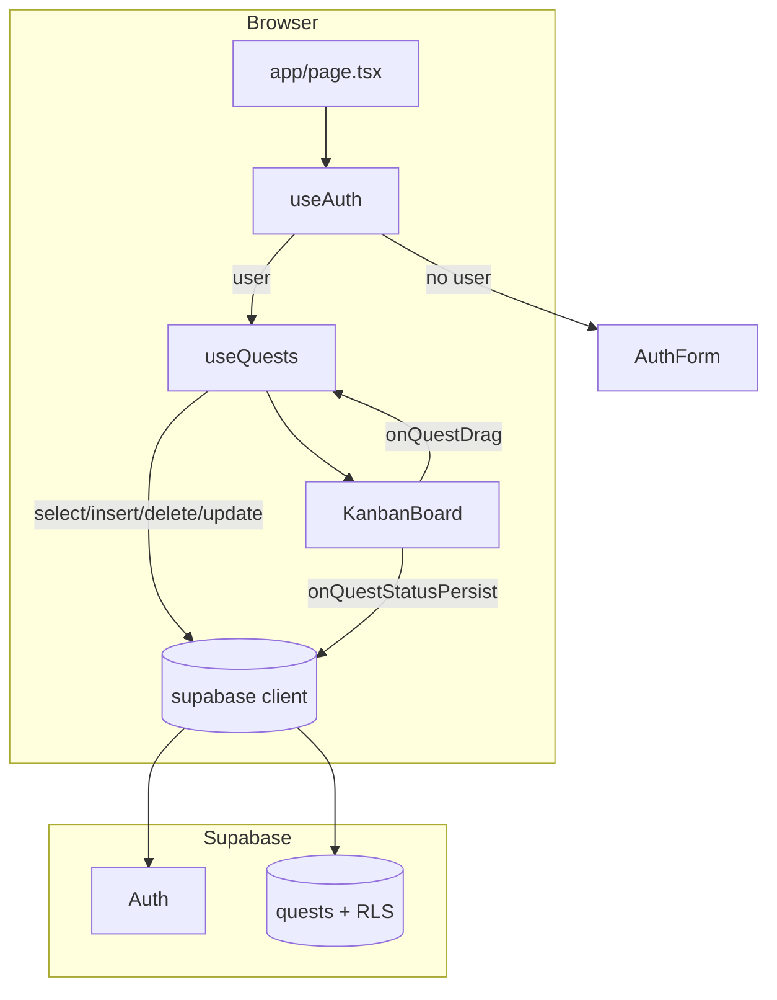

# The Daily Quest — Architecture

> **Living document rule (for humans and AI):** Before editing this file, read the existing `ARCHITECTURE.md` and scan the current codebase. Merge updates intelligently—preserve accurate history, note what changed, and do not blindly overwrite prior sections. Update the [Document history](#document-history) entry for each meaningful revision.

---

## The Vision

**The Daily Quest** is an AI-ready **gamified accountability coach** dressed as a medieval tavern notice board. Adventurers (users) draft quests, organize them on a Kanban board, and earn XP when they complete work—turning daily habits into a lightweight RPG loop.

The product has evolved from a **browser-only prototype** (local persistence) into a **cloud-connected MVP** with **Supabase Authentication**, per-user quest storage, and client-side gamification—positioned for a future **Phase 3** where an AI coach (Vercel AI SDK) can reason over quests and campaigns.

---

## Tech Stack

| Layer | Technology | Role |
|--------|------------|------|
| Framework | **Next.js 16** (App Router) | `app/page.tsx` as the single routed surface; client components for interactivity |
| UI | **React 19**, **Tailwind CSS v4** | Tavern-themed layout, typography (Cinzel + Merriweather via `next/font`) |
| Drag & drop | **@dnd-kit** (`core`, `sortable`, `utilities`) | Kanban columns, sortable cards, drag overlay |
| Backend / auth | **Supabase** (`@supabase/supabase-js`) | Postgres `quests` table, email/password auth, session in browser |
| Language | **TypeScript** | Shared `Quest` / `QuestStatus` types in `types/quest.ts` |

**Environment:** `NEXT_PUBLIC_SUPABASE_URL` and `NEXT_PUBLIC_SUPABASE_ANON_KEY` in `.env.local` (see `lib/supabase/client.ts`).

**Note:** `@supabase/ssr` is listed in `package.json` but not wired yet—the app uses the browser client only.

---

## Application State & Data Flow

### Separation of concerns: “Brain” vs UI

The **custom hook** [`hooks/useQuests.ts`](hooks/useQuests.ts) is the application brain. It owns:

- Quest list state, form drafts (`draftText`, `campaign`, `isMilestone`)
- Gamification state (`xp` → derived `level`, `xpProgress`)
- Supabase CRUD: fetch on mount, insert on add, delete on remove
- Optimistic drag status updates via `handleQuestDrag`

**Presentation** stays thin:

| UI module | Responsibility |
|-----------|----------------|
| [`app/page.tsx`](app/page.tsx) | Auth gate (`useAuth`), composes board vs `AuthForm` |
| [`components/AddQuestForm.tsx`](components/AddQuestForm.tsx) | Controlled inputs; calls `handleAddQuest` |
| [`components/KanbanBoard.tsx`](components/KanbanBoard.tsx) | `@dnd-kit` context; delegates drag + DB persist |
| [`components/BoardHeader.tsx`](components/BoardHeader.tsx) | Level bar, sign-out |
| [`lib/quests/drag.ts`](lib/quests/drag.ts) | Pure helpers: `resolveTargetStatus`, `applyQuestDrag` |
| [`lib/quests/normalize.ts`](lib/quests/normalize.ts) | Maps DB/API shapes → `Quest` |

[`hooks/useAuth.ts`](hooks/useAuth.ts) mirrors the same pattern for auth: session bootstrap + `onAuthStateChange`, consumed only by the page shell.

### End-to-end flow (authenticated user)



1. **Mount:** `useAuth` resolves session; unauthenticated users see `AuthForm`.
2. **Load quests:** `useQuests` runs `select *` ordered by `created_at`; rows are normalized (`is_milestone` → `isMilestone`).
3. **Add quest:** Optimistic append → `insert` → rollback filter on error.
4. **Drag quest:** `handleQuestDrag` updates local state immediately; `KanbanBoard` calls `updateQuestStatusInDB` when status actually changes (fire-and-forget).
5. **Delete:** Optimistic remove → `delete` → restore quest on error.

### Optimistic UI

The MVP applies **optimistic updates** for perceived speed; the server is the source of truth for quests, with rollback on failure:

| Action | Optimistic behavior | Persistence | Rollback |
|--------|---------------------|-------------|----------|
| Add quest | Append to `quests` immediately | `insert` into `quests` | Remove new row if `error` |
| Delete quest | Remove from `quests` | `delete` by `id` | Re-append `deletedQuest` if `error` |
| Drag / status change | `applyQuestDrag` updates `quests` + may award XP | `update({ status })` via `updateQuestStatusInDB` | *Not implemented*—status is not reverted on failed update |

Loading UX: `isMounted` gates the Kanban behind [`KanbanSkeleton`](components/KanbanSkeleton.tsx) until the first fetch completes.

### Legacy prototype (Phase 1)

[`lib/quests/storage.ts`](lib/quests/storage.ts) (`loadBoardState` / `saveBoardState`, key `daily_quests_v1`) implemented **localStorage** persistence with default seed quests. **Nothing in the active app imports this module anymore**—it remains as a reference to the pre-Supabase prototype. Gamification and quests now live in React state + Supabase for quests only.

---

## Gamification Engine

Constants live in [`lib/quests/constants.ts`](lib/quests/constants.ts):

| Constant | Value |
|----------|-------|
| `XP_PER_QUEST` | **50** |
| `XP_PER_MILESTONE` | **250** |

### When XP is awarded

XP is granted **only** when a quest is dragged into the **`completed`** column and its **previous** status was not `completed` (see `shouldAwardXp` in `useQuests`).

```ts
const xpGain = activeQuest.isMilestone ? XP_PER_MILESTONE : XP_PER_QUEST;
setXp((prev) => prev + xpGain);
```

- Standard quest (`isMilestone: false`): **+50 XP**
- Milestone / “Epic Quest” (`isMilestone: true`): **+250 XP**
- Moving out of `completed` or between non-completed columns: **no XP change**
- Re-dragging an already completed quest: **no duplicate XP** (guarded by prior status check)

### Level and progress bar

Computed in `useQuests` (1-based level):

| Derived value | Formula | UI |
|---------------|---------|-----|
| `level` | `Math.floor(xp / 100) + 1` | “Level {n} Architect” in `BoardHeader` |
| `xpProgress` | `xp % 100` | Progress bar width and “{xpProgress} / 100 XP” |

Examples: `xp = 0` → Level **1**, bar at **0**; `xp = 99` → Level **1**, bar at **99**; `xp = 100` → Level **2**, bar at **0**.

Milestone quests are surfaced in [`QuestItem`](components/QuestItem.tsx) (gold border, ★, “Sub-Boss” label).

### Current limitation (important)

**XP is held only in React state**—it is **not** written to Supabase or localStorage in the MVP. A full page refresh resets XP to `0` while completed quest **status** remains in the database. Persisting XP (or deriving it from completed rows) is a natural follow-up.

---

## Database Schema

The app expects a Postgres table **`quests`** (managed in Supabase). The TypeScript domain model [`types/quest.ts`](types/quest.ts) maps to columns as follows:

| Column (DB) | App field | Type / notes |
|-------------|-----------|--------------|
| `id` | `id` | `text` — client generates `"q_" + Date.now()` on insert |
| `text` | `text` | Quest description |
| `campaign` | `campaign` | Grouping label; defaults to `"General Campaign"` if empty on create |
| `status` | `status` | `"pending"` \| `"in-progress"` \| `"completed"` |
| `is_milestone` | `isMilestone` | `boolean` — epic / boss quests |
| `created_at` | *(not on Quest type)* | Used for `order("created_at", { ascending: true })` on fetch |
| `user_id` | *(not sent from client on insert)* | Should tie each row to `auth.uid()` — typically set via **column default** (`auth.uid()`) and/or **RLS**; required for multi-tenant isolation |

**Client insert payload** (see `handleAddQuest`): `id`, `text`, `campaign`, `status`, `is_milestone` only. **`user_id` is assumed to be filled by the database** from the authenticated session.

**Status updates:** `updateQuestStatusInDB(id, newStatus)` → `.update({ status }).eq("id", id)`.

There is **no SQL migration file in this repo**; treat the table above as the contract between app and Supabase project settings.

---

## Authentication & Security

### Client-side auth guard

There is **no Next.js middleware** route protection. The guard is **entirely client-side** in [`app/page.tsx`](app/page.tsx):

```tsx
const user = useAuth();
if (!user) return <AuthForm />;
return <TavernBoard />;
```

[`useAuth`](hooks/useAuth.ts):

1. Calls `supabase.auth.getSession()` on mount.
2. Subscribes to `supabase.auth.onAuthStateChange` for login/logout.
3. Returns `User | null` to the page.

[`AuthForm`](components/AuthForm.tsx) supports **sign in** and **sign up** via `signInWithPassword` / `signUp`. [`BoardHeader`](components/BoardHeader.tsx) exposes **Sign Out** via `supabase.auth.signOut()`.

The Supabase JS client attaches the user’s JWT to subsequent `from("quests")` calls automatically.

### Row Level Security (RLS)

RLS policies are **configured in Supabase** (not in this repository). The application **assumes** policies along these lines:

| Operation | Intended policy |
|-----------|-----------------|
| `SELECT` | Rows where `user_id = auth.uid()` |
| `INSERT` | Allowed for authenticated users; `user_id` matches `auth.uid()` (default or check) |
| `UPDATE` / `DELETE` | Only rows owned by `auth.uid()` |

With RLS enabled and no valid session, quest queries fail or return empty—complementing the UI auth gate. **Do not rely on the UI alone** for security; RLS is the enforcement layer on the database.

**Secrets:** Only the **anon** key is used in the browser (`NEXT_PUBLIC_*`). Service role keys must never ship to the client.

---

## Project layout (reference)

```
app/                 # layout, globals, page (auth + board shell)
components/          # Kanban, forms, auth, header
hooks/               # useQuests, useAuth
lib/
  quests/            # constants, drag, normalize, legacy storage
  supabase/          # browser client
types/               # Quest, QuestStatus
```

---

## Future Roadmap

### Phase 3: Vercel AI SDK Integration

_Placeholder — not started._

Planned direction: an accountability **coach** that can read quest/campaign context, suggest next actions, and eventually participate in the loop (e.g. breaking milestones into sub-quests). Integration point: server-side or streamed routes using the **Vercel AI SDK**, with quest data fetched under the same Supabase auth/RLS model.

**Related follow-ups before or with Phase 3:**

- Persist **XP / level** (profile table or derived from `quests` where `status = 'completed'`)
- Revert optimistic status updates on failed `update`
- Optional: wire `@supabase/ssr` + middleware for server-rendered auth
- Remove or archive unused `lib/quests/storage.ts` when history is fully captured here

---

## Document history

| Date | Summary |
|------|---------|
| 2026-05-29 | Initial living architecture doc: Phase 1 localStorage → Phase 2 Supabase MVP, gamification math, hook-based data flow, auth guard, schema contract, Phase 3 placeholder. |
